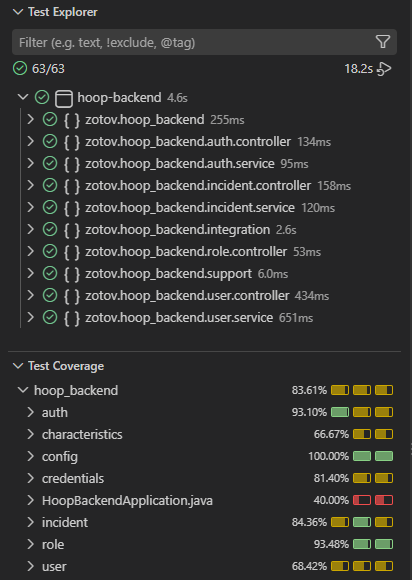

# Testing y cobertura

## Comando

```powershell
mvn test
```

## Resultado verificado

```text
Tests run: 50, Failures: 0, Errors: 0, Skipped: 0
Cobertura JaCoCo de instrucciones: 81.3%
```

## Reporte

El reporte HTML se genera en:

```text
target/site/jacoco/index.html
```

Captura de cobertura:



## Tipos de tests

### Unitarios

Cubren:

- reglas de negocio de incidencias
- creacion de usuarios internos
- email duplicado
- rol inexistente
- cambio obligatorio de password
- carga de usuario para Spring Security
- bloqueo de token si `mustChangePassword = true`
- controladores de auth, usuarios, roles e incidencias con mocks

### Integracion

Cubren:

- arranque del contexto Spring Boot
- JPA con H2 en memoria
- Spring Security
- MockMvc
- login con Basic Auth
- cambio de password inicial
- creacion de incidencia por usuario autenticado
- filtrado por rol/departamento
- permisos de cierre
- bloqueo de edicion sobre incidencias cerradas

## Exclusiones de cobertura

Para que la cobertura mida logica real, se excluyen:

- aplicacion principal
- configuracion
- DTOs
- entidades
- enums
- repositorios
